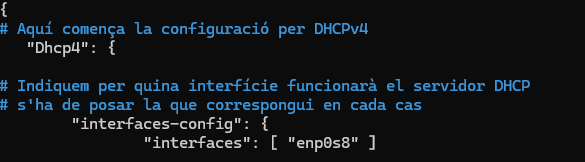
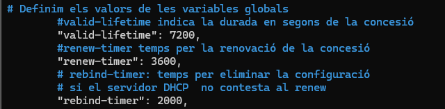
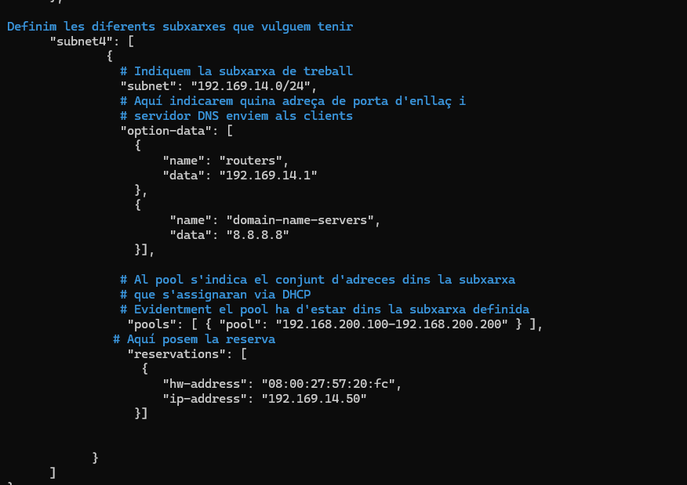
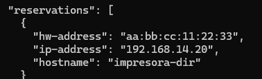
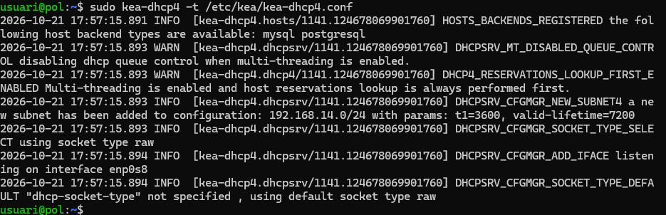
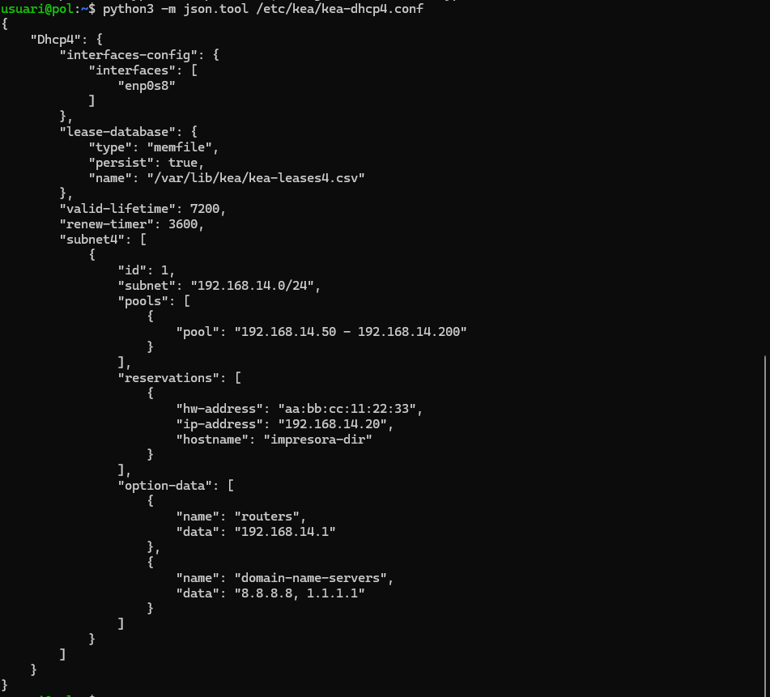
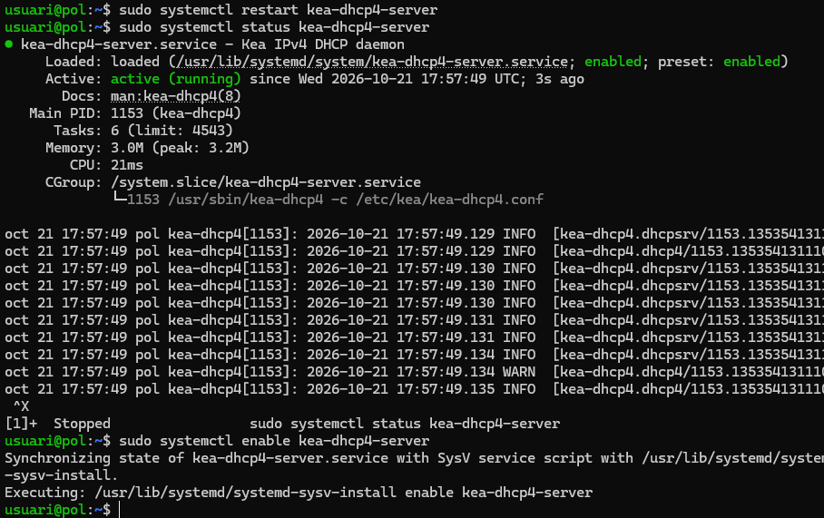
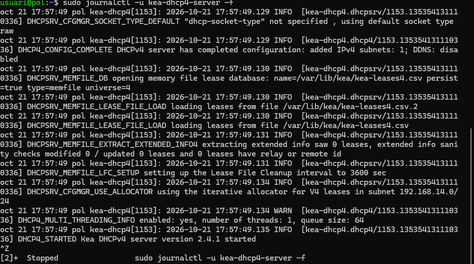
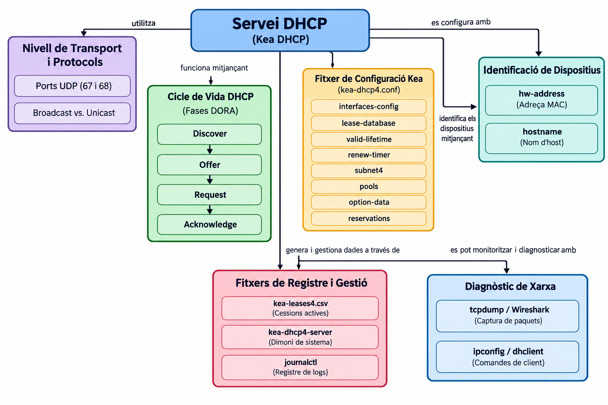

### 1. Procés de negociació (DORA)

1.1. Descriu la funció dels quatre missatges del cicle DHCP (Discover, Offer, Request, Acknowledge).
- Discover: el client busca un servidor DHCP disponible a la xarxa.
- Offer: el servidor DHCP ofereix una adreça IP al client.
- Request: el client sol·licita formalment l'adreça IP que ha acceptat.
- Acknowledge (ACK): el servidor confirma l'assignació de l'adreça IP i envia la configuració de xarxa.

1.2. Indica quines d'aquestes fases es realitzen mitjançant missatges de tipus Broadcast i quines en Unicast en un entorn local sense DHCP Relay.

El missatge Discover s'envia per Broadcast. El missatge Offer es pot enviar per Broadcast o Unicast. El missatge Request normalment s'envia per Broadcast. El missatge Acknowledge (ACK) es pot enviar per Broadcast o Unicast, segons les condicions del client i del protocol.
### 2. Captura i capçaleres de paquet


2.1. Especifica els ports UDP font i destí utilitzats pel client i pel servidor DHCP.

El client utilitza el port UDP 68 com a port d'origen i el port 67 com a port de destinació quan envia missatges al servidor. El servidor utilitza el port UDP 67 com a port d'origen i el port 68 com a port de destinació quan respon al client.

2.2. Quin camp de la capçalera DHCP s'utilitza per identificar unívocament la targeta de xarxa (NIC) del client?

El camp és chaddr (Client Hardware Address), que conté l'adreça MAC de la targeta de xarxa del client. També existeix l'opció 61, anomenada Client Identifier, que es pot utilitzar per identificar el client.

2.3. Identifica el número o nom de les opcions DHCP encarregades de transmetre la porta d'enllaç per defecte (Router), els servidors DNS i el nom de domini.
- Opció 3 (Router): indica la porta d'enllaç per defecte.
- Opció 6 (Domain Name Server): indica els servidors DNS.
- Opció 15 (Domain Name): indica el nom de domini de la xarxa.


## Bloc 2: Configuració del Servidor Kea DHCP (kea-dhcp4.conf)
Redacta l'estructura del fitxer de configuració JSON per al dimoni kea-dhcp4 complint els requisits següents:

1. Interfície i Emmagatzematge:
- Configuració de la interfície de xarxa eth0.
- Model de base de dades de cessions en memòria (memfile) amb persistència activada.
2. Paràmetres Globals i de Temps:
- Temps de cessió (valid-lifetime): 2 hores (7200 segons).
- Temps de renovació (renew-timer): 1 hora (3600 segons).
3. Subxarxa i Pool Dinàmic:
- Adreça de xarxa: 192.168.x.0/24.
- Rang d'adreces dinàmiques assignables (pool): Des de la 192.168.x.50 fins a la 192.168.x.200.
4. Opcions de Xarxa (option-data):
- Encaminador / Porta d'enllaç: 192.168.x.1.
- Servidors DNS primari i secundari: 1.1.1.1 i 8.8.8.8.
- Nom de domini local: oficina.local.


## Bloc 3: Assignació Estàtica (Reserves per Adreça MAC)
Afegeix la secció de reserves (reservations) dins de la configuració de la subxarxa per garantir una adreça IP fixa a una impressora de xarxa de l'oficina:

1. Paràmetres de la reserva:
- Adreça MAC de la targeta (hw-address): aa:bb:cc:11:22:33.
- Adreça IP assignada: 192.168.x.20.
- Nom de l'equip (hostname): impresora-dir.
2. Validació de Sintaxi:
- Indica quines eines o comandes utilitza Kea o el sistema per comprovar que el fitxer JSON no conté errors de sintaxi abans d'iniciar el servei.
## Bloc 4: Comprovació, Diagnòstic i Resolució d'Incidències

1. Comprovacions al Servidor:
- Quines comandes de systemctl permeten verificar l'estat, reiniciar o aturar el servei de Kea DHCP?
- Mitjançant quines comandes o utilitats del sistema (journalctl / registres) es poden consultar les peticions i incidències del servei Kea?
- En quina ruta i quin fitxer emmagatzema Kea la llista de cessions actives (leases) quan s'utilitza el motor memfile?
2. Proves des del Client:
- Especifica les comandes necessàries en un client Linux (dhclient / nmcli / ip) per alliberar la IP actual i sol·licitar-ne una de nova.

Alliberar l'adreça IP actual i sol·licitar-ne una de nova:

```bash
sudo dhclient -r eth0
sudo dhclient eth0
```

Amb nmcli:

Desconnectar i tornar a connectar la connexió de xarxa:
nmcli connection show
```bash
sudo nmcli connection down "Connexió cablejada 1"
sudo nmcli connection up "Connexió cablejada 1"
```

Substitueix "Connexió cablejada 1" pel nom real de la connexió que apareix a la primera comanda.

Amb ip:
```bash
sudo ip addr flush dev eth0
sudo dhclient eth0
```


- Especifica les comandes equivalents en un client Windows (ipconfig).

Alliberar l'adreça IP actual:

```bash
ipconfig /release
```


Sol·licitar una adreça IP nova:
```bash
ipconfig /renew
```


Comprovar la configuració de xarxa:
```
ipconfig /all
```

## Bloc 5: Disseny del Mapa Conceptual del Servei DHCP
Dibuixa o esquematitza un mapa conceptual que connecti visualment tots els components del servei. En el mapa han d'aparèixer obligatòriament els següents conceptes i relacions (sense incloure la seva definició o explicació):

- Nivell de Transport i Protocols: Ports UDP (67 i 68), Broadcast vs. Unicast.
- Cicle de Vida DHCP: Fases DORA (Discover, Offer, Request, Acknowledge).
- Fitxer de Configuració Kea (kea-dhcp4.conf): Paràmetres interfaces-config, lease-database, valid-lifetime, renew-timer, subnet4, pools, option-data i reservations.
- Identificació de Dispositius: Adreça MAC (hw-address) i Nom d'host (hostname).
- Fitxers de Registre i Gestió: Cessions actives (kea-leases4.csv), dimoni de sistema (kea-dhcp4-server) i registre de logs (journalctl).
- Diagnòstic de Xarxa: Captura de paquets (tcpdump / Wireshark) i comandes de client (ipconfig / dhclient).
